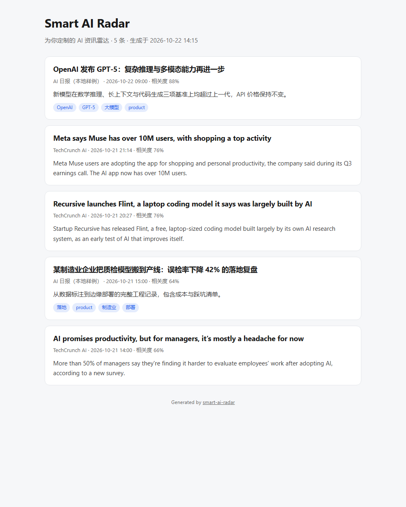

# Smart AI Radar

> 按「你是谁」而不是「什么最热」来排序的 AI 资讯雷达。

从多个 RSS/JSON 源抓取 AI 资讯，用一个可读可改的 **Persona** 描述你的关注点，再把结果输出成 **HTML / Markdown / JSON / JavaScript**。没有数据库，没有前端构建，`npm start` 就能跑。



```
data/sources-config.json ──► NewsEngine ──► Persona 过滤 ──► OutputGenerator
   (RSS + JSON 源)           (抓取/去重/打分)   (categories/tags/        (html/md/json/js)
                                               keywords)
```

## 为什么做这个

大多数 AI 资讯聚合器只有一种排序：时间或者热度。但研究者想看的是论文和基准，工程师想看的是实现和踩坑，创业者想看的是融资和赛道——同一批文章，三种人应该看到三种结果。

Smart AI Radar 把「视角」抽出来变成数据：一个人格就是一个 JSON 文件，里面写清楚它关心哪些分类、标签和关键词。改人格不用改代码。

## 特性

- **多源聚合**：本地 JSON、远程 RSS 2.0 / Atom、远程 JSON，混着配就行。
- **Persona 过滤**：内置 4 个人格（学术 / 行业 / 工程 / 创业），也可以自己加一个 JSON 文件。
- **四种输出**：同一份数据同时渲染成 HTML 页面、Markdown 文档、JSON 和可嵌入的 JS 组件。
- **相关性打分**：关键词命中 + 新鲜度，输出 0–1 的分数并按分数排序。
- **零构建**：只有 3 个运行时依赖（express / cors / helmet），测试用 Node 内置 test runner。
- **优雅降级**：单个源挂掉只记一条 warn，不影响其他源。

## 快速开始

```bash
git clone https://github.com/stonearro/smart-ai-radar.git
cd smart-ai-radar
npm install
npm start
```

打开 <http://localhost:3000>，或在浏览器里直接看渲染结果：

```
http://localhost:3000/api/news?formats=html&raw=1&persona=academic-researcher
```

可选配置（不配置也能跑）：

```bash
cp .env.example .env
# PORT=3000 / LOG_LEVEL=info
```

## API

| 方法 | 路径 | 说明 |
| --- | --- | --- |
| GET | `/` | 服务信息与可用格式 |
| GET | `/api/health` | 健康检查（源数量、人格数量、uptime） |
| GET | `/api/sources` | 当前生效的资讯源 |
| GET | `/api/news` | 抓取 + 过滤 + 渲染 |
| GET | `/api/personas` | 人格列表，支持 `?category=` |
| GET | `/api/personas/:id` | 单个人格 |
| GET | `/api/personas/recommend` | 按用户画像推荐人格 |
| POST | `/api/personas` | 新建人格（写入 `personas/`） |
| PUT | `/api/personas/:id` | 修改人格 |
| DELETE | `/api/personas/:id` | 删除人格 |
| POST | `/api/export` | 把结果写成文件到 `output/` |

### `/api/news` 参数

| 参数 | 示例 | 说明 |
| --- | --- | --- |
| `formats` | `html,markdown` | 逗号分隔，可多选；默认 `json` |
| `format` | `html` | `formats` 的单数别名 |
| `persona` | `academic-researcher` | 人格 id |
| `language` | `zh-CN` | 语言过滤 |
| `categories` | `research,startup` | 分类过滤 |
| `tags` | `论文,paper` | 标签过滤 |
| `keywords` | `推理,benchmark` | 正文关键词过滤 |
| `minRelevance` | `0.5` | 相关性下限（0–1） |
| `limit` | `10` | 返回条数，1–100 |
| `raw` | `1` | 单格式时直接返回文档本体，而不是 JSON 包裹 |
| `profile` | `{"language":"zh-CN"}` | 用一个 JSON 传完整画像，上面的参数会覆盖它 |

默认返回 JSON 包裹：

```json
{
  "success": true,
  "data": { "markdown": "# Smart AI Radar\n\n..." },
  "metadata": { "total": 6, "available": 9, "formats": ["markdown"], "profile": {} }
}
```

> `data.json` 是**对象**而不是字符串；其他格式是字符串。

### 交互式调参

```bash
# 学术视角，最近 5 条，直接看 HTML
curl "http://localhost:3000/api/news?persona=academic-researcher&limit=5&formats=html&raw=1"

# 一次拿三种格式
curl "http://localhost:3000/api/news?categories=research&formats=html,markdown,json&limit=3"

# 导出成文件
curl -X POST http://localhost:3000/api/export \
  -H "content-type: application/json" \
  -d '{"formats":["html","markdown"],"limit":5,"profile":{"persona":"technical-builder"}}'
```

## Persona 怎么写

`personas/*.json`，文件名就是 id：

```json
{
  "name": "学术研究员",
  "description": "关注论文、基准测试和研究方法。",
  "category": "academic",
  "language": "zh-CN",
  "expertise": ["机器学习", "自然语言处理"],
  "filter": {
    "categories": ["research"],
    "tags": ["论文", "paper", "benchmark"],
    "keywords": ["论文", "实验", "arxiv"]
  },
  "credibilityWeight": 0.9,
  "outputFormats": ["html", "markdown"]
}
```

`filter` 里三个维度是**或**的关系：命中任意一个就算相关（分类命中、标签命中、正文命中关键词）。三个都为空则不过滤。`category`、`language`、`credibilityWeight` 用于 `/api/personas/recommend` 的排序。

## 资讯源怎么配

`data/sources-config.json`：

```json
{
  "sources": [
    { "name": "本地样例", "type": "json", "url": "data/news/rss/ai-news-daily.json", "priority": 1 },
    { "name": "TechCrunch AI", "type": "rss", "url": "https://techcrunch.com/category/artificial-intelligence/feed/", "priority": 3 },
    { "name": "某个关掉的源", "type": "rss", "url": "https://example.com/feed", "enabled": false }
  ]
}
```

- `url` 是相对路径就读本地文件，是 `http(s)` 就抓网络。
- `type` 不写也行：会自动判断 JSON / RSS / Atom。
- 远程请求 5s 超时，失败只打 warn。
- 想让测试完全不联网：`RADAR_SOURCES_FILE=test/fixtures/sources.offline.json`。

## 输出格式

| 格式 | 形态 | 适用场景 |
| --- | --- | --- |
| `html` | 自包含单页，明暗主题自适应 | 直接打开 / 静态托管 |
| `markdown` | 带标题层级和分隔线的文档 | GitHub、Obsidian、周报 |
| `json` | `{ generatedAt, articles: [...] }` | 喂给别的程序 |
| `javascript` | 挂 `window.SmartAIRadar` 的 IIFE | 嵌到任意网页 |

JS 组件用法：

```html
<div id="ai-radar"></div>
<script src="output/widget.js"></script>
<script>SmartAIRadar.render('#ai-radar');</script>
```

## 生成静态站点

```bash
npm run build:site
npm run build:site -- --persona technical-builder --limit 10 --language zh-CN
```

产物在 `output/`：`index.html`、`feed.md`、`feed.json`、`widget.js`。

## 测试

```bash
npm test
```

16 个用例，覆盖全部路由、四种格式、参数校验、人格过滤、导出落盘和 404。测试使用 `test/fixtures/sources.offline.json`（仅本地源），所以**不依赖网络**，也不会写脏工作区。

## 项目结构

```
smart-ai-radar/
├── src/
│   ├── index.js              # Express 应用 + 路由
│   ├── core/
│   │   ├── engine.js         # 抓取 / 去重 / 打分 / 过滤
│   │   └── persona.js        # 人格加载与 CRUD
│   ├── output/
│   │   └── generator.js      # html / markdown / json / javascript
│   └── utils/
│       ├── logger.js         # 无依赖日志
│       └── env.js            # 无依赖 .env 读取
├── personas/                 # 人格即数据
├── data/
│   ├── sources-config.json   # 源配置
│   └── news/                 # 本地样例数据
├── scripts/build-site.js     # 静态站点生成
└── test/api.test.js          # node:test
```

## 设计取舍

- **没有数据库**：资讯是短命的，缓存 5 分钟足够了；要持久化就存 `output/` 的产物。
- **没有 LLM 调用**：过滤靠显式规则，可预测、可测试、零成本。想加摘要，接在你自己的 `/api/news` 之后即可。
- **人格是文件不是代码**：可以进 git、可以 review、可以分享，改人格不需要重启服务之外的任何东西。
- **RSS 解析器只有 30 行**：够用就好，遇到奇怪的 feed 就换一个源。

## Roadmap

- [ ] 并发抓取限流与按源重试
- [ ] 抓取结果落盘做增量（只拉新条目）
- [ ] Persona 继承与组合
- [ ] 按源的历史命中率动态调整 `credibilityWeight`
- [ ] Dockerfile 与 GitHub Actions 定时构建静态站

## License

[MIT](LICENSE)
